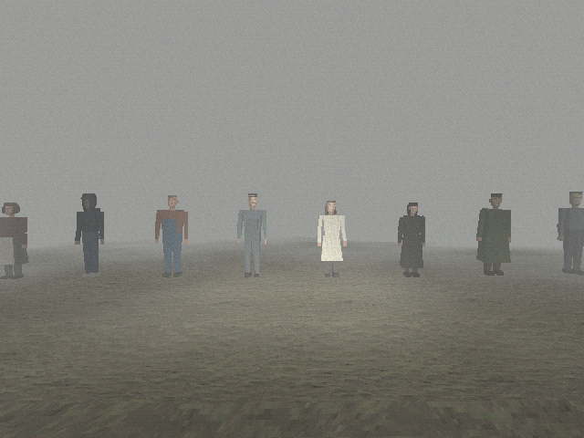
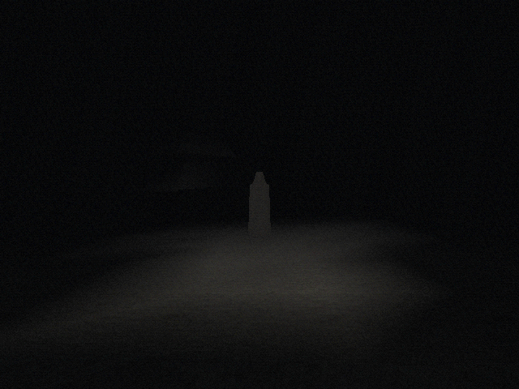
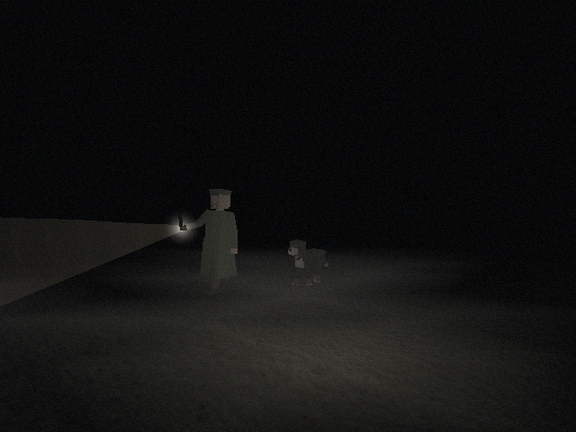

# Characters, scares, and the patrol

How levels place the cast, stage the beats in [script/07-scares.md](script/07-scares.md), and set up Raymond's round from [script/04-cemetery.md](script/04-cemetery.md). The test scene `characters_test` shows all of it.



 

## Code layout

| Path | Contents |
|---|---|
| `src/engine/characters/` | Models built from boxes, pose curves, the `Character` runtime that walks and looks, animal sounds |
| `src/game/kit/npc.ts` | `kit.npc(id)`, the level builder for a cast member |
| `src/game/scares/` | Beat data, the scare director, figures, random events, the sound palette |
| `src/game/patrol/` | The watchman's round, torch beam, and detection rules |
| `src/levels/characters_test/` | The test scene |

## Placing characters

`kit.npc(id)` adds a cast member and returns a builder. Ids are the cast ids from [script/00-overview.md](script/00-overview.md): `overney`, `monique`, `yannick`, `bernard`, `gilles`, `christine`, `odile`, `raymond`, `driver`, plus `marc` (Le Loyon, always masked), `bari`, and `marquise`.

```ts
kit.npc('overney').at(2, 0, -4).faceYaw(180).watch(4).talk('overney');
kit.npc('bernard').at(-3, 0, 1).talk('bernard_shovel_ask', 'Ask about the shovel');
kit.npc('gilles').at(6, 0, 2).walk([{ x: 6, z: -4, wait: 3 }, { x: 6, z: 2, wait: 5 }], { loop: true });
const marquise = kit.npc('marquise').at(30, 0, -12).faceYaw(90);
```

| Method | Effect |
|---|---|
| `.at(x, y, z)`, `.faceYaw(deg)` | Place and turn. Characters stand on the ground under them; `y` only matters on raised floors. Yaw follows the level convention: 0 faces -Z. |
| `.talk(dialogue, prompt = 'Talk')` | Interact plays a dialogue. Pass a node id (`raymond_night1`), a cast id for the person's entry table (`monique`), or a `DialogueScript`. The character turns to the player while it runs. |
| `.watch(radius = 4)` | The head follows the player while they are within `radius` meters. |
| `.walk(points, { loop?, speed? })` | Walks the waypoints. A point with `wait` stands there for that many seconds. |
| `.followPlayer(distance = 2.5)` | Follows the player, as Marquise does on the way home. |
| `.sit(height = 0)` | Already seated when the scene opens, on a seat `height` meters above the ground under the character. Use about 0.48 for a kitchen chair, or 0 when the character stands on the seat itself, such as Marc on his walkable bed. |
| `.character` | The live `Character`, for scripted moves in triggers and `update`. |

Place NPCs at the top level of the kit, not inside `kit.group`, because they walk in world coordinates.

`.character` has `walk(points)` and `walkTo(x, z)`, which return a promise that resolves at the end, plus `follow(target, distance)`, `stop()`, `face(yawOrPoint)`, `lookAt` (a `Vector3` the head turns to, or `null`), `position`, `yaw`, and `events.on('step' | 'arrive', ...)`. `sit(height, { instantly? })` sits down where the character is over about a second, `stand()` gets up, and `sitting` tells which. Walking stands a seated character up first, as Yannick does when he leaves the garage bench on day 3. A seated character turns only the head toward the player during a talk, never the body.

```ts
// Marc after the monologue: he walks to the bed and sits on its edge.
await marc.character.walk([{ x: 2.8, z: 0.15 }, { x: 4, z: 1.35 }]);
marc.character.sit(0);
```

```ts
kit.trigger({ r: 2 }).at(0, 0, -6).once().onEnter(async () => {
  const bus = driver.character;
  await bus.walkTo(3, -2);
  bus.face(ctx.player.position);
});
```

Bari's collar bell rings on his steps and Marquise's cowbell on hers. Both stay silent while the animal stands still.

### How they look and move

- Humans are about 300 triangles: tapered boxes for limbs, a box head with the face texture's middle on the front, and per-person clothes from `humanLooks` in `src/engine/characters/cast.ts`. The options are a coat, a skirt, overalls, an apron, a clerical collar, and a flat cap, peaked cap, PostBus cap, headscarf, or hood. Standing, they breathe and shift their weight. Walking, their legs swing about 25 degrees and their arms swing against the legs. Seated, the thighs are level, the shins hang, the back slumps a little, and the hands rest on the knees. A `stoop` in `humanLooks` bends the back forward and keeps the head level.
- Le Loyon is a hooded camo cape from shoulders to ankles with the gas mask in the hood. He has no visible arms and never takes the mask off. Standing, he doesn't breathe, and every 13 seconds or so his head tilts and stays tilted. Before turning he stands still for 0.7 s, then turns all at once. He walks at 0.62 m/s, half a normal pace, and limps on his left leg. Seated, he folds forward over his knees with his boots out in front, and the hem of the cape sinks through the seat.
- Bari trots with diagonal legs together. Marquise walks one leg at a time. Both lower their heads now and then while standing.

| Character | Face texture |
|---|---|
| Overney | `face_priest` |
| Monique | `face_innkeeper` |
| Yannick | `face_young_woman` under a dark hood, a stand-in |
| Bernard | `face_farmer` |
| Gilles | `face_mechanic` |
| Christine | `face_young_woman` |
| Odile | `face_old_woman` |
| Raymond | `face_watchman` |
| PostBus driver | `face_mechanic`, a stand-in |

## Staging scare beats

Beats are data. Write them as a list and hand them to the director with `kit.use`:

```ts
import { scareDirector } from '../../game/scares/director';

const scares = kit.use(scareDirector([
  {
    id: 'cem1_back_wall',
    when: [{ flag: 'read_grave_menoud' }, { flag: 'read_grave_gremaud' }, { flag: 'read_grave_chassot' }],
    if: { flag: 'met_raymond' },
    do: [
      { silence: 20 },
      { figure: { at: { x: 0, z: -14 }, vanish: 'never', near: 12, leave: [{ x: 1.5, z: -15 }, { x: 1.5, z: -24 }] } },
      { sound: 'sfx_gate_creak_back', at: { x: 1.5, z: -15 }, after: 9 },
    ],
    set: 'first_sighting',
  },
  {
    id: 'vil_follow',
    when: { enter: { x: 0, z: -10, w: 6, d: 3 } },
    if: { notFlag: 'met_veilleur' },
    do: [{ stalk: { surface: 'stone', steps: 12 } }],
  },
], { random: { surface: 'gravel' } }));
```

A beat fires once, the first frame all of its triggers and its `if` condition hold. With `set`, it also sets that flag, and a beat whose flag is already set never fires again, so beats stay spent across visits. With `repeat: seconds`, the beat can fire again after its triggers stop holding, at most that often.

### Triggers

| Trigger | Holds when |
|---|---|
| `{ enter: { x, z, r } }` or `{ enter: { x, z, w, d } }` | The player has walked into the zone. Starting inside doesn't count until they leave and come back. |
| `{ flag: 'id' }` | The flag is set. |
| `{ after: seconds }` | The scene has been loaded that long. |
| `{ look: { x, y?, z, angle?, within?, hold? } }` | The player looks at the point: within `angle` degrees of the view center (default 10), closer than `within` meters (default 20), for `hold` seconds (default 0.4). |

`when` takes one trigger or a list. A list means all of them.

### Actions

Every action takes `after: seconds` to delay it from the moment the beat fires.

| Action | What happens |
|---|---|
| `{ figure: { at, who?, face?, walk?, vanish?, hold?, near?, leave?, timeout? } }` | A figure, Le Loyon unless `who` names someone else. It appears only while its spot is out of view, so it is there when the player turns. A spot past the edge of the fog counts as out of view too, so a figure on the path ahead is there already and comes out of the fog as the player walks on (`fogSight` in `src/game/scares/fogSight.ts` works out where the fog hides everything, from the live fog uniforms). It stands on the ground at its spot. With `vanish: 'seen'` (default) it is gone after being looked at directly for `hold` seconds (0.8). With `'unseen'` it is gone the first time it leaves the view after being seen. With `'never'` it stays. If the player comes within `near` meters (8), it walks off along `leave`, or is gone at once without one. With `walk` it walks those points at its own slow pace and is gone at the end, which makes a figure that crosses the path ahead and isn't there when you look back. |
| `{ sound: id, at?, distance?, volume? }` | One sound from a point `{ x, z }`, or `distance` meters (default 12) `'behind'`, `'ahead'`, `'left'`, or `'right'` of the player. |
| `{ stalk: { surface?, steps?, distance? } }` | Footsteps 7 m behind the player that answer each of their steps 0.3 s late, with a dragged foot every second step. When the player stops, one more step comes, then nothing. |
| `{ silence: seconds }` | Every ambient bed fades out over 1.5 s, stays out, then returns over 3 s. |
| `{ fog: { far?, density?, seconds, fade? } }` | The fog eases to these values (default: closes in to 60% of `far` and 1.8 times the density), holds, and eases back. When the values thin the fog, the camera's far plane moves out with it for as long as it lasts, so what the thinner fog uncovers is drawn. The barn roof at the forest fork uses this to show 26 m up the branch. |
| `{ stinger: id \| true, at? }` | The loud hit of a real jumpscare. `true` plays `sfx_hit`; the three jumpscares use `sfx_bark`, `sfx_floorboard`, and `sfx_breath_mask`. |
| `{ run: (ctx) => ... }` | Any code, such as a dialogue after a stinger. |

Sound ids, all synthesized: `sfx_step_other`, `sfx_branch`, `sfx_breath_mask`, `sfx_cough_mask`, `sfx_bell_dog`, `sfx_whistle_raymond`, `sfx_gate_squeal`, `sfx_gate_creak_back`, `sfx_metal_cup`, `sfx_knock_metal`, `sfx_static`, `sfx_floorboard`, `sfx_bark` (three barks), `sfx_growl`, `sfx_hit`. Play one outside a beat with `playSound(ctx.audio, id, { at })` from `src/game/scares/sounds.ts`.

### The director

`kit.use(scareDirector(beats, options))` returns the `ScareDirector`:

- `scares.fire('id')` plays a beat now, whatever its triggers say.
- `scares.block(seconds)` keeps random events away, for example during the watchman's approach.
- `options.random` turns on the random events from the table in 07-scares.md: at least 75 s apart, a 6% chance in each 10 s window, and a pool of footsteps (40%), a branch (35%), an 8 s silence (20%), and a mask breath (5%, once per scene). Turn it on only outdoors at night and in the bunker. Each fixed beat holds random events back for 60 s, and nothing happens during dialogue.

Beats, figures, and timers pause while a dialogue or menu is open.

## The watchman's round

```ts
import { watchmanPatrol } from '../../game/patrol/patrol';
import { dialogues } from '../../content';

const patrol = kit
  .use(watchmanPatrol({
    route: [
      { x: 0, z: 30 },                                   // offstage, down the path
      { x: 0, z: 6, gate: true },                         // the front gate squeals
      { x: 0, z: -12, wait: 5, aim: { x: 2, z: -16 } },   // the back wall and the Chassot plot
      { x: -3, z: -12, wait: 3, aim: { x: -6, z: -14 } }, // Daniel's lantern
      { x: 0, z: 6, gate: true },
      { x: 12, z: 30 },                                   // down the far side
    ],
    rest: 40,
    grounds: [{ x: 0, z: -4, w: 24, d: 22 }],
    suspicious: [{ x: 2, z: -15, r: 3 }],
    safe: [{ x: 9, z: -10, w: 2, d: 2 }],
    evidence: [{ at: { x: 2, z: -15 }, active: () => ctx.state.count('dig_stage') >= 1 && !ctx.state.hasFlag('tarp_over_hole') }],
  }))
  .onRound(() => scares.block(45))
  .onSeen(() => void ctx.dialogue(dialogues.raymond_night2_warn))
  .onCaught(() => void ctx.dialogue(dialogues.raymond_caught));
```

Raymond walks the route with Bari at heel, rests offstage for `rest` seconds, and starts again. Set `once: true` for the single pass on night 1. Change `patrol.rest` at any time, for example to shorten the round after the warning.

He gives himself away in this order:

1. Bari's collar bell rings on the dog's steps. The sound is positional, so start the route 20 m or more outside the grounds.
2. Raymond whistles his four notes every 7 to 10 s while he is outside the grounds.
3. His torch beam swings ahead of him and shows through the fog. A point light lands where the beam meets the ground.
4. The gate squeals at every stop marked `gate`.

While he stands at a stop with `aim`, the torch sweeps around that spot.

Detection follows 04-cemetery.md, with a torch cone 12 m long and 25 degrees wide:

| Cause | Rule | Result |
|---|---|---|
| `flashlight` | The player's flashlight is on inside `grounds` while Raymond is within 30 m. | Caught |
| `evidence` | The beam touches an active `evidence` spot while the player is inside `grounds`. | Caught |
| `beam` | The beam touches a standing player. A crouched player is safe when a collider stands between them and the torch, unless Bari has given them away and Raymond is within 4 m. | Caught inside a `suspicious` zone, otherwise `onSeen`, once per round |

The player is never seen inside a `safe` zone. If the player comes within 3 m of Bari, he growls once. If they are still within 3 m of the route 4 s later, Raymond turns his torch on them for 3 s.

When the player is caught, the round stops, Raymond and Bari face the player, the torch stays on them, Bari keeps barking, and `onCaught` runs. `patrol.catch()` ends the round the same way from level code, for example on a sighting after the warning. `patrol.caught` tells whether it happened, and `patrol.raymond` and `patrol.bari` are the two `NpcBuilder`s.

## Crouching

C, left Ctrl, or the gamepad's LB toggles crouching. The eye drops from 1.65 m to 1.05 m, the player walks at 0.6 m/s, and their steps are quieter. Loading a scene stands the player up. `ctx.player.crouched` reads the state.

## The test scene

`characters_test` is a foggy pasture. Spawns: `default` faces the row of villagers and animals. `view_<id>` stands 3 m in front of each of them. `view_marc` and `view_marc_close` face Le Loyon at the tree line, 10 m and 3.6 m away. `path` starts the gravel path north, which runs through a stalker, a figure behind the player, a look trigger on the bare tree, a walker, a cough, and a stinger at the end. `patrol` stands beside the walled plot where Raymond does his round.

Flags: `test_patrol_now` starts the round after 3 s, `test_walk` makes the row walk up and down, and `test_loyon_walk` makes Le Loyon pace.

```sh
npm run shot -- --scene characters_test --time night --flags test_patrol_now --pos 25,0,6 --yaw -140 --frames 380 --out /tmp/patrol.png
```

Screenshots of every character by day are in `screenshots/characters-<id>.png`.
