# Engine

How to run the game and how to build a level on the engine. Level authors only need the [level kit](#level-kit), [scenes](#scenes), [dialogue](#dialogue), [story state](#story-state-from-the-content), and [documents and photos](#documents-photos-and-the-notebook) sections, plus the [example level](#example-level).

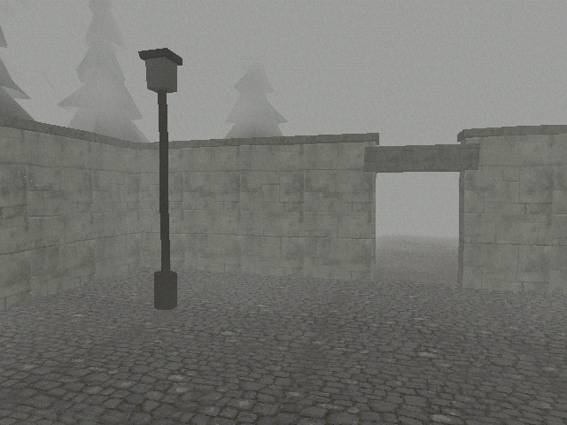 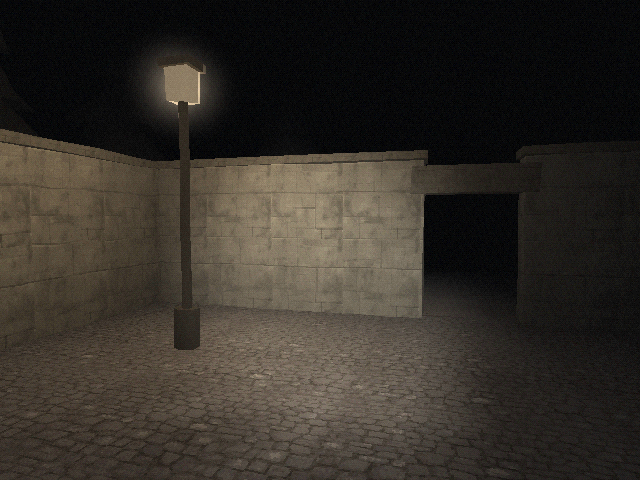

## Running

| Command | What it does |
|---|---|
| `npm install` | Installs dependencies. If `node_modules/electron/dist` is missing afterwards, run `node node_modules/electron/install.js`. |
| `npm run dev` | Vite dev server. Open the printed URL in Chromium or Firefox. |
| `npm run electron:dev` | The desktop app against the dev server, with live reload. F12 opens DevTools. |
| `npm run electron` | Builds, then runs the desktop app from `dist/`. |
| `npm run build` | Type-checks, builds the web game into `dist/`, and compiles `electron/` into `dist-electron/`. |
| `npm test` | Unit tests (Vitest). |
| `npm run typecheck` | `tsc` over the game and the Electron main process. |
| `npm run smoke` | Plays through the `test` scene in headless Chromium and checks prompts, dialogue, collision, doors, menus, and saving. |
| `npm run shot -- --scene <id> --out <file.png>` | Saves one 640x480 frame. See below. |

F11 or Alt+Enter toggles fullscreen in the desktop app.

### Screenshots

```sh
npm run shot -- --scene test --out /tmp/test.png
npm run shot -- --scene test --time night --pos -0.5,0,1.2 --yaw 16 --out docs/screenshots/x.png
```

Options: `--time day|night`, `--pos x,y,z`, `--yaw deg`, `--flags a,b`, `--frames N` (frames to wait after the scene fades in, default 90), `--size WxH` (viewport, default 640x480). The script starts its own dev server and runs Chromium with SwiftShader, so it works without a GPU. Page errors are printed after the file is saved; 404s for missing textures are expected and ignored.

### Debug URL parameters

`?scene=<id>&time=<day|night>&day=n&night=n&flags=a,b&pos=x,y,z&yaw=deg` loads any scene directly. `day` and `night` set the story counts of the same names, so `?scene=cemetery&time=night&night=2` opens the night of the dig. Without `pos`, the player starts at the scene's `default` spawn. With `pos`, `y` is the height the player starts from, and the player drops onto the highest ground below it, so pass a high `y` on slopes. Without `scene`, the game opens on the [title screen](#title-screen-and-settings).

### `window.__game`

For automated tests. Defined in `src/game/debug.ts`.

| Member | Use |
|---|---|
| `ready` | `true` once the first scene, or the title screen, has faded in. Wait for it before anything else. |
| `state()` | Snapshot: `{ scene, time, flags, inventory, player }`. |
| `pose()` | `{ x, y, z, yaw }` of the player. |
| `scenes()` | Registered scene ids. |
| `loadScene(id, spawnOrPose?)` | Loads a scene with no fade. |
| `teleport(x, y, z, yawDeg)` | Moves the player. |
| `setTime('day' \| 'night')` | Changes the time of day; the atmosphere updates at once. |
| `press(action, frames = 2)` | Holds an input action for some frames. Actions: `up`, `down`, `left`, `right`, `fast`, `interact`, `cancel`, `inventory`, `flashlight`, `crouch`, `camera`, `pause`. |
| `waitFrames(n)` | Resolves after `n` rendered frames. |
| `prompt()` | The visible interaction prompt text, or `null`. |
| `dialogue()` | The dialogue step on screen, or `null`. |
| `modal()` | What holds the input: `'dialogue'`, `'document'`, `'screen'` for any other screen or menu, or `null`. |
| `hotspots()` | The interactions enabled now, as `{ prompt, x, z }`. |
| `approach(prompt, near?)` | Stands the player on free ground in reach of the enabled interaction with that prompt, facing it. With several, takes the one closest to `near`, or to the player. Returns `false` when there is none or no spot works. |
| `characters()` | The cast on stage, as `{ id, x, z, visible }`. |
| `setSpeed(factor)` | Multiplies the game clock, to get through held actions and long waits. 1 is normal. |
| `game` | The `Game` object, for anything else. `game.input.simulate(action, down)` holds an action until released. |

`tools/smoke.mjs` shows how to drive the game with these hooks, and the [playthrough test](playthrough.md) plays every ending with them.

## Layout

| Path | Contents |
|---|---|
| `src/engine/render/` | Renderer, PS1 material, lighting rig, atmosphere, post pass, textures, geometry, tree models |
| `src/engine/physics/` | XZ collision and ground height |
| `src/engine/input/` | Key and gamepad bindings, the `Input` class |
| `src/engine/audio/` | `AudioManager`, procedural generators, footsteps |
| `src/engine/ui/` | The overlay: prompt, dialogue box, menus, document and photo views, viewfinder, fade, notices, the font |
| `src/engine/player.ts` | Tank controls, head bob, footstep events |
| `src/game/` | `Game` loop, state, saves, settings, dialogue runner, items, inventory, notebook, scenes, the level kit, debug hooks |
| `src/game/camera/` | The Polaroid: viewfinder, shots, prints, photo ids, camera sounds |
| `src/content/` | The script as data: dialogues, documents, items, flags, notebook, endings |
| `src/title/` | The title screen |
| `src/levels/<id>/` | One folder per scene |
| `src/main.ts` | Starts the game at the title, or at `?scene=` |

## Conventions

- **Units.** Meters and seconds. Angles in the level API are degrees.
- **Axes.** Y is up. The ground is the XZ plane.
- **Yaw.** 0 faces -Z, 90 faces -X, 180 faces +Z, -90 faces +X. Positive `rotY` turns counterclockwise seen from above.
- **Origins.** Boxes, cylinders, roofs, sprites, and doors have their origin at the bottom center, so `.at(x, 0, z)` stands them on the floor. Planes, terrains, and glows are centered on their origin.
- **Colors.** Hex numbers such as `0xffc070`. There is no sRGB conversion: the value you write is the value lit and shown.

## Scenes

A scene is a plain object. Export it from `src/levels/<area>/index.ts` as part of `export const scenes: Scene[]`; `src/levels/index.ts` collects every area with a glob.

```ts
import { defineScene } from '../../game/scene';

export const churchScene = defineScene({
  id: 'church',
  spawns: {
    default: { x: 0, z: 8, yaw: 0 },        // y is optional; the player stands on the ground
    from_cemetery: { x: 6, z: -2, yaw: 90 },
  },
  atmosphere: { day: { ... }, night: { ... } },
  build(kit, ctx) { ... },                   // may be async
  update(dt, ctx) { ... },                   // optional, every frame
  dispose(ctx) { ... },                      // optional, before unloading
});
```

Meshes, colliders, ground, lights, triggers, hotspots, and scene sounds are cleaned up automatically when the scene unloads. Use `dispose` only for things you started yourself, such as timers.

### Atmosphere

```ts
atmosphere: {
  day: {
    fog: { color: 0x9c9e9a, near: 1, far: 16, density: 0.08, wisps: 0.45 },
    ambient: 0x6e6e6a,
    sun: { color: 0x5a5a54, direction: [0.35, 1, 0.5] }, // direction points toward the light
    saturation: 0.7,
  },
  night: {
    fog: { color: 0x07080a, near: 0.5, far: 13, density: 0.11, wisps: 0.3 },
    ambient: 0x15171c,
    sun: { color: 0x0e1118, direction: [-0.4, 1, 0.3] },
    saturation: 0.6,
  },
},
```

| Field | Meaning |
|---|---|
| `fog.color` | Fog and sky color. Day fog is grey-white, night fog near black. |
| `fog.near`, `fog.far` | Fog starts at `near` meters and is opaque at `far`. Nothing past `far` is drawn, so keep `far` between 10 and 20. |
| `fog.density` | Adds exponential-squared fog on top of the linear ramp. 0 is off, 0.08 is thick, 0.15 is very thick. |
| `fog.wisps` | 0 to 1. Drifting noise that thins and thickens the fog in patches. Default 0.35. |
| `ambient` | Light on every surface. Interiors at night: about `0x0c0d10`. |
| `sun` | Optional directional light: overcast sky by day, moonlight at night. |
| `saturation` | 1 keeps colors, 0 is grey. Default 0.75. |
| `flashlight` | Whether the flashlight starts on. Default: on at night, off by day. |

### Scene context

`build`, `update`, and `dispose` get a `ctx`:

| Member | Use |
|---|---|
| `ctx.state` | Flags, inventory, time of day. See [state](#state-items-and-saves). |
| `ctx.player` | `position` (a `Vector3`), `yaw` in radians, `forward()`, `camera`, and `events.on('footstep', ...)`. |
| `ctx.audio` | The `AudioManager`. See [audio](#audio). |
| `ctx.goTo(sceneId, spawn?)` | Fades out and loads another scene. |
| `ctx.dialogue(script)` | Plays a dialogue; the promise resolves when it ends. Player input pauses meanwhile. |
| `ctx.ask(script)` | Plays a dialogue like `ctx.dialogue` and resolves with the text of the last choice the player picked, or `null`. Use it to act on a choice without storing a flag, as the cemetery dig does with "Dig." and the fort's field telephone with "Turn the crank.". |
| `ctx.say(lines, speaker?)` | Shortcut for a one-node dialogue: `ctx.say('It is locked.')`. |
| `ctx.readDocument(id)` | Shows `documents[id]` from `src/content` full-frame, page by page. Resolves when the player closes it. See [documents](#documents). |
| `ctx.notify(text)` | A short line in the top-right corner, such as "Saved." Receiving an item shows "Got: <name>" by itself. |
| `ctx.time` | Seconds since the scene finished loading. |
| `ctx.paused` | `true` while a dialogue, menu, screen, or scene change holds the player still. |
| `ctx.held(action)` | Whether an input action is held this frame, for actions held over time such as digging. |
| `ctx.openScreen(element, update)` | Shows a full-frame HTML element, such as a computer desktop, and gives `update(dt, input)` all input until the returned handle's `close()` runs. Dialogues still show on top and hand input back to it. |

## Level kit

`build(kit, ctx)` receives a `LevelKit`. Every method adds something and returns a builder; builder methods return the builder, so a whole object is one chain:

```ts
kit.box({ w: 4, h: 2.6, d: 0.5 }).texture('stone_wall', { tile: 2.5 }).at(0, 0, -6).rotY(90).collider();
```

Colliders, ground patches, lights, hotspots, and triggers register after `build` returns, using each object's final position. The order of calls in a chain doesn't matter, and objects inside a group get world positions.

### Shapes

| Method | Shape |
|---|---|
| `kit.box({ w, h, d, cell? })` | Box. Origin at bottom center. `w` is along X, `d` along Z. |
| `kit.plane({ w, d, cell? })` | Upward-facing floor, centered. |
| `kit.ceiling({ w, d, cell? })` | Downward-facing plane, centered. |
| `kit.cylinder({ r, h, sides?, cell? })` | Upright cylinder, default 8 sides. Origin at bottom center. |
| `kit.gable({ w, d, h, cell? })` | Gable roof, ridge along X, `h` above the eaves. Origin at bottom center. |
| `kit.terrain({ w, d, cell?, height })` | Heightfield. `height(x, z)` gets coordinates relative to the terrain center and returns meters. It gets darker and lighter vertex-color patches by itself. |
| `kit.sprite(texture, { w, h })` | Picture that turns to face the camera around Y, standing on its bottom edge. Transparent texels are cut out. Use it for weeds, ferns, distant trees, and figures. |
| `kit.glow(size, color?)` | Soft additive halo, centered. Put one on every lamp bulb at night. |
| `kit.mesh(geometry)` | Any Three.js `BufferGeometry` with the PS1 material. UVs are multiplied by the texture's `1 / tile`. |

`cell` is the size in meters of the grid that faces are split into, default 1. Lighting is per vertex, so a big floor needs vertices for the flashlight and lamps to light it: use 0.5 to 0.75 for floors the player looks at closely, 2 for large terrain. Smaller cells also reduce texture warping.

### Mesh builder methods

These work on everything above except `glow`.

| Method | Effect |
|---|---|
| `.at(x, y, z)` | Position, relative to the parent group. |
| `.rotY(deg)` | Turn around Y. |
| `.onGround()` | Moves the object onto the ground below it. The `y` given to `at` becomes an offset above the ground. |
| `.texture(name, { tile? })` | Texture from `public/assets/textures/<name>.png`. `tile` is the meters covered by one copy, one number or `[across, up]`, default 2. A missing file falls back to a procedural texture picked by keywords in the name (stone, wood, grass, bark, and so on), so levels work before the art exists. |
| `.color(hex)` | Multiplies the texture. Also the way to draw an untextured object. |
| `.emissive(hex)` | Adds self-lit color. |
| `.unlit()` | Ignores all lights; fog still applies. Use it for bulbs, lit windows, screens. |
| `.doubleSided()` | Draws back faces too. |
| `.cutout(threshold = 0.5)` | Discards transparent texels, for fences and leaves. |
| `.collider()` | Blocks the player. Boxes and other meshes use their footprint, turned with the object. Cylinders use a circle. |
| `.walkable(surface = 'stone')` | The player can walk on top. Surfaces: `grass`, `gravel`, `wood`, `stone`, `snow`. The surface picks the footstep sound. |
| `.interact({ prompt, onInteract, radius?, enabled?, photo? })` | Shows "[E] prompt" when the player faces the object within reach and runs `onInteract` on the button. `prompt` can be a function. `enabled` can hide the interaction. `photo` marks it as a [camera target](#the-polaroid-camera). |
| `.dynamic()` | Keeps the object and its children out of [`kit.batch`](#batching-still-meshes) merging. Works on groups too. |
| `.mesh` and `.object` | The Three.js mesh, for animating it in `update`. |

### Other builders

| Method | What it adds |
|---|---|
| `kit.trees(kind, spots)` | Instanced trees built from alpha cards. `kind` is a stock kind (`'spruce'`, `'bare'`, or `'birch'`), a model from `foliage.ts`, or a list of models; with a list, the spots are dealt out among the models in turn. Stock kinds deal out two or three seeds of the card models below. Each spot is `{ x, z, scale?, yaw? }`; trees stand on the ground under them, sunk 0.15 m. Chain `.collider()` to block at each trunk, and `.shade(spread)` to darken or lighten each tree by up to `spread` (0.12 is about right), keyed on its spot. |
| `scatter({ x, z, w, d, count, seed?, spacing?, avoid?, scale? })` | Returns repeatable random spots in a rectangle for `kit.trees` or anything else. `avoid(x, z)` returns `true` to keep paths clear. Import from `src/game/kit/scatter`. |
| `spotsAlong(points, { step, seed?, jitter?, scale? })` | Spots every `step` meters along a line through `[x, z]` points, each turned so its +X runs along the line, for hedges, verges, and ivy. `jitter` pushes spots up to that far off the line. Override `yaw` on the result to face ivy out from a wall. Import from `src/game/kit/scatter`. |
| `kit.light({ color?, intensity?, range? })` | Point light. `.flicker(0 to 1)`, `.at(...)`. Up to 8 lights are active at once; the nearest win. After the build, `.light` is the live light; change its `position` or `intensity` in `update` to carry or dim it. |
| `kit.hotspot({ prompt, onInteract, radius?, enabled?, photo? })` | An invisible interaction point. Chain `.at(...)`. `photo` works as on `.interact`. |
| `kit.trigger({ w, d } \| { r })` | Invisible area. `.onEnter(fn)`, `.onExit(fn)`, `.once()`. Use it for scares and story beats. Spawning inside a trigger doesn't fire it. |
| `kit.barrier({ w, d } \| { r })` | Invisible wall. Close off the edges of every outdoor level. |
| `kit.door({ to, spawn?, w?, h?, texture?, prompt?, locked?, lockedText? })` | A door slab (default 1 x 2.1 m, texture `door_wood`) with a collider. Using it loads scene `to` at spawn `spawn`. When `locked()` returns `true`, it shows `lockedText` instead. |
| `kit.exit({ w, d, to, spawn? })` | An area that loads another scene when the player walks in. |
| `kit.group(build)` | Builds children relative to a group; place the group with `.at()` and `.rotY()`. Use it for props made of several parts, such as a house. |
| `kit.batch(build)` | Builds children in a group, then merges their meshes that share a material into one draw call each, and returns what `build` returns. See [batching](#batching-still-meshes). |
| `kit.sound(src, { volume?, loop?, refDistance? })` | A sound file playing from a point, `.at(...)`. Loops by default. |
| `kit.ambience('wind' \| 'drone' \| 'crackle', { volume?, interval?, distance? })` | Procedural background sound for the scene. `crackle` places random twig snaps and clicks around the player; `interval` is the average gap in seconds. |
| `kit.ground(surface, height = 0)` | The ground where no walkable object covers it. Call it first in every outdoor scene. |
| `kit.texture(name)` | The `Texture` object, for custom materials. |

### Trees and greenery

All trees and plants are alpha cards, as in the forest: crossed quads cut out with `alphaTest` and drawn double-sided, instanced through `kit.trees`, so a stand of a hundred costs a few draw calls per model. Don't build trees, bushes, or hedges from solid shapes. The models live in `src/game/kit/foliage.ts`; each takes a seed, and the same seed gives the same model.

| Model | What it is |
|---|---|
| `leafySpruce(seed, { ivy? })` | A ten-meter Norway spruce, whorls of drooping needle cards. The stock `'spruce'`. |
| `leafyBeech(seed, { ivy?, lean? })` | A November beech with copper leaf sprays. `lean` tips it toward +X, for trees over a trail. |
| `bareTree(seed, { height?, crownBase?, spread?, leaves?, ivy? })` | A bare broadleaf tree: real limbs inside a twig crown painted on three crossed planes, and a few dead leaves clinging. Height 10 and spread 1 for a lime, spread 1.5 for a walnut, height 5 with `crownBase` 1.4 and spread 1.6 for an orchard tree. `leaves` is the share of twig tips still holding leaves. The stock `'bare'`. |
| `birchTree(seed)` | A birch, its crown on crossed planes. The stock `'birch'`. |
| `yew(seed, { height?, radius? })` | A dark churchyard yew or cypress, needle sprays reaching up and out to a ragged point. |
| `thicket(seed, { length, depth, count, plants })` | Upright plant cards, each paired with one crossed at a right angle, in a `length` by `depth` patch along X. One bush, a stretch of hedge, or a run of verge. `plants` is `HEDGE_PLANTS` (a clipped beech hedge keeping its dead leaves), `WILD_PLANTS` (bramble, saplings, young spruce), `VERGE_PLANTS` (dead grass, bramble, fern), or your own list. |
| `ivyCover(seed, { w, h })` | Ivy lying against a wall in the XY plane, thick at the foot, ragged at the top. Place it with the wall behind its -Z side. |

A hedge or verge is a few `thicket` seeds dealt along a line, plus a barrier for a hedge:

```ts
const hedge = ['a', 'b'].map((seed) => thicket(`garden-${seed}`, { length: 2.6, depth: 1, count: 9, plants: HEDGE_PLANTS }));
kit.trees(hedge, spotsAlong([[-6, 0], [6, 0]], { step: 2.1, seed: 'garden', jitter: 0.15 }));
kit.barrier({ w: 12, d: 1 }).at(0, 0, 0);
// Ivy on a wall that faces west (-X): turn each sheet's +Z to face out.
kit.trees(ivyCover('barn', { w: 3, h: 4 }), [{ x: -5.03, z: 2, yaw: -90 }]);
```

Pictures that fill their whole width, such as `undergrowth`, show the straight edge of their card in a thicket; use them through `billboards` with `ragged` in `forest_path/woods.ts` instead. Past what the player sees up close, use camera-facing pictures (`tree_spruce`, `tree_beech_bare`, `tree_birch`, `tree_dead_snag`) through `billboards`, as the cemetery does for the spruce beyond its walls. Keep many small plants such as grass tufts in one `billboards` call rather than one `kit.sprite` each.

Ground height comes from walkable objects: the player stands on the highest one under them that is at most 0.45 m above their feet. Without any, the fallback from `kit.ground` applies.

### Batching still meshes

Three.js walks and culls every mesh each frame, so a village of hundreds of small parts costs CPU time even when nothing moves. `kit.batch` builds a part of the level as usual and, once colliders and ground patches have registered, merges the meshes that would draw with the same texture, emissive, cutout, side, and flags. Each part's color and texture tiling go into its vertices, so the result looks the same. The village square went from 1,694 meshes to 110 this way, the cemetery from 761 to 137.

```ts
const { church, street } = kit.batch((still) => ({
  church: churchFront(still, ctx, night),
  street: streetFurniture(still, ctx, night),
}));
```

Sprites, glows, instanced trees, and hidden meshes stay as they are. Anything the level later moves, hides, or recolors must not be merged: build it outside the batch, or chain `.dynamic()` on it or on its group, as the village does for the curtain, the lit panes, and the phone box lamp. Hotspots, colliders, and lights inside a batch work as anywhere else. The merged meshes are culled as one, so batch an area the player sees most of at once, not a whole map behind walls.

For many copies of one picture standing on the ground, such as grass tufts, use `billboards(kit, picture, spots)` from `src/levels/forest_path/woods.ts`, which draws them as one instanced mesh.

### Custom geometry

For shapes the kit lacks, build a `BufferGeometry` and pass it to `kit.mesh`. For full control, `createPs1Material(options)` in `src/engine/render/ps1Material.ts` gives the PS1 material for any Three.js mesh: `map`, `color`, `emissive`, `uvScale`, `alphaTest`, `unlit`, `billboard`, `glow`, `vertexColors`, `side`. Every material shares the fog and lighting uniforms, so it fits the scene automatically.

## Dialogue

Dialogue is data. Write scripts as typed objects; the runner in `src/game/dialogue.ts` is pure logic with unit tests.

```ts
import type { DialogueScript } from '../../game/dialogue';

export const priest: DialogueScript = {
  start: [{ if: { flag: 'met_priest' }, to: 'again' }, { to: 'hello' }],
  nodes: {
    hello: {
      speaker: 'Abbé Overney',
      lines: ['Good evening.', 'You are not from Leurs.'],
      effects: { set: 'met_priest' },
      choices: [
        { text: 'Ask about the cemetery', next: 'cemetery' },
        { text: 'Show him the photo', if: { item: 'photo' }, effects: { take: 'photo' }, next: 'photo' },
        { text: 'Leave' },
      ],
    },
    cemetery: { speaker: 'Abbé Overney', lines: ['Take this. The gate sticks.'], effects: { give: 'cemetery_key' } },
    photo: { lines: ['He looks at it for a long time.'] },
    again: { speaker: 'Abbé Overney', lines: ['Back again?'] },
  },
};
```

- A node shows its `lines` one at a time. If it has `choices`, they appear with the last line.
- A line can be `{ if, text }`: it shows only while the condition holds, checked when the node starts, after the node's own effects. A node whose lines and choices all drop out jumps straight on.
- `effects` on a node apply when the node starts. `effects` on a choice apply when it is picked.
- `next` and `start` are a node id or a list of `{ if?, to }`; the first entry whose condition holds wins. No `next`, or no match, ends the dialogue.
- A node with no lines and no visible choices jumps straight on, which makes it a branch point.
- Conditions: `{ flag, notFlag, item, notItem, count, any: [...], all: [...], not: {...} }`. `flag` to `notItem` take one id or a list. `count` is a list of tests such as `['marc_trust', '>=', 2]`, with `==`, `!=`, `<`, `<=`, `>`, `>=`. `any` holds when one of its conditions does, `all` when every one does; use `all` to combine conditions that set the same field. Every field present must hold.
- Effects: `{ set, clear, give, take, assign, add }`, applied in that order. `set` to `take` take one id or a list. `assign: { night: 1 }` sets counts, `add: { marc_trust: 1 }` adds to them.
- `validateScript(script)` returns the jumps to missing nodes. Content tests should expect `[]`.

Play it with `ctx.dialogue(priest)`. The player confirms with interact; while text is typing, interact shows the whole line.

How lines show:

- A node with no `speaker` is narration, the reporter's eye and thoughts. It shows in italics, a little dimmer, with no name label, as the script convention asks.
- A French line carries its English in double braces: `'Bouge pas! {{Don\'t move!}}'`. The box shows "Bouge pas!" and, once the line has typed out, "Don't move!" on its own smaller line underneath. Several `{{...}}` in one line are joined. The subtitles setting hides the English.
- Script dialogues from the content are ready to play: `ctx.dialogue(dialogues.monique)` follows Monique's entry table, `ctx.dialogue(dialogues.grave_chassot_look)` plays one node and ends at once if its `?if:` fails.

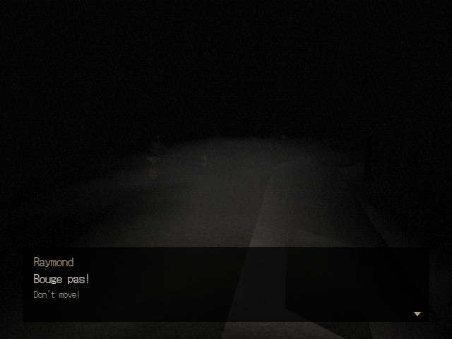 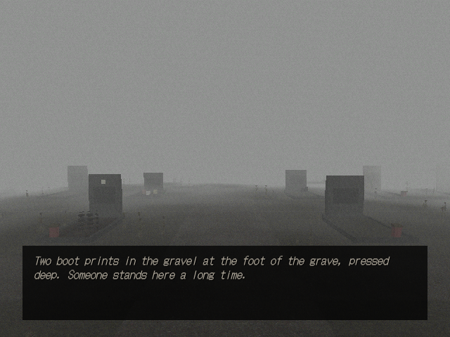

## State, items, and saves

`ctx.state` is a `GameState`:

- `hasFlag(f)`, `setFlag(f, on = true)`
- `count(name)`, `setCount(name, value)` for numeric story values such as `day`, `night`, `dig_stage`, `marc_trust`, and `film_shots`. An unset count reads as 0.
- `hasItem(id)`, `giveItem(id)`, `takeItem(id)`, `inventory` (each item at most once, in pickup order)
- `photo(item)` and `photos` for the camera's prints
- `time` (`'day'` or `'night'`; setting it updates the atmosphere at once), `scene`
- `events.on('flag' | 'count' | 'item' | 'time', handler)`

`check(condition, state)` and `apply(effect, state)` in `src/game/conditions.ts` use the same condition and effect format as dialogue, for doors, triggers, and hotspots.

Items need a name and description for the inventory screen:

```ts
import { registerItems } from '../../game/items';
registerItems({ cemetery_key: { name: 'Cemetery key', description: 'Heavy, with a bent bit.' } });
```

Items from the script register themselves when anything imports `src/content`.

Saves go to `localStorage` under `le-loyon.save.<slot>`, as JSON with a `version`. A save holds flags, counts, inventory, photos, scene, time, and pose. The pause menu saves to slot `main`. Slot `auto` is written every time a scene finishes loading, so a browser player who closes the tab loses at most one area. Slot `sleep` is the save made when the reporter wakes at the inn and when they set out on night 2; the caught screen loads it. "Continue" on the title and "Load game" in the pause menu load the newest of the three (`CONTINUE_SLOTS` in `src/game/game.ts`, `latestSave` in `src/game/save.ts`). When the format changes, raise `SAVE_VERSION` in `src/game/save.ts` and add a migration from the old version to `migrations`, so old saves keep loading.

## Story state from the content

`src/content` holds the script as data. Import from its index:

```ts
import { checkStory, dialogues, documents, holds, notebook, type DocumentId, type Flag } from '../../content';
```

- **Flags.** `flags.story` lists the stored flags. Some flags in the script are derived instead: `pro_knows_village`, `suspects_empty_coffin`, `has_evidence`, and `has_shovel`, `has_food`, `has_bunker_key`, `has_legion_tag`, `has_ring`, which follow the items. The game never stores derived flags, so `state.hasFlag('suspects_empty_coffin')` is always false. Read any flag with `holds(flag, ctx.state)`, and test conditions from the content with `checkStory(condition, ctx.state)`, which expands derived flags before it checks. Plain `check` does not.
- **Counts.** `flags.counts` lists each numeric value with its range: `day` (1 to 4), `night` (0 to 3, 0 by day), `dig_stage`, `refill_stage`, `marc_trust`, `film_shots` (0 to 10), and `forum_stage`.
- **Dialogues** compiled from the script already have their node conditions and derived flags expanded.

## Documents, photos, and the notebook

### Documents

`ctx.readDocument(id)` shows a document from `src/content/documents.ts` over a dark backdrop, one page at a time. Pages hold up to 10 lines of 64 characters, as the content paginates them. Interact, right, or down turns the page and closes the last one; left or up goes back; cancel closes. The promise resolves on close, so a level can set a flag after the player has read it:

```ts
kit.hotspot({ prompt: 'Read the letter', onInteract: async () => {
  await ctx.readDocument('doc_gremaud_letter');
  ctx.state.setFlag('read_gremaud_letter');
} }).at(1, 0, 2);
```

French documents show the original on the sheet and the English in smaller type underneath. When the two paginate to different lengths, the view has as many pages as the longer one and spreads the shorter one across them. Gravestones (`grave_*`, `oldstone_*`, `doc_forest_cross`) are carved into a stone shape; everything else is paper. Items with a `document` in `src/content/items.ts` open the same view from the inventory.

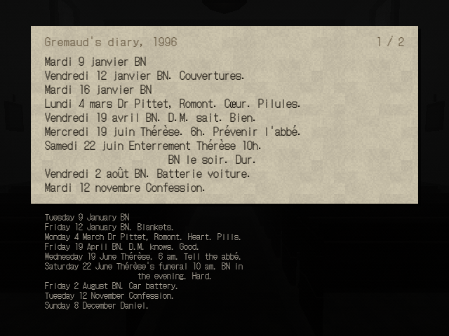 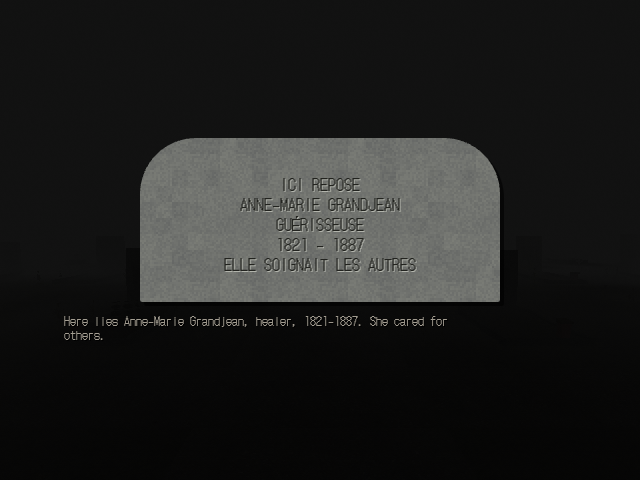

### The Polaroid camera

With the `polaroid_camera` item, Q (LT on a gamepad) or "Raise the camera" in the inventory brings up the viewfinder. Turning still works, at half speed, for framing. Interact shoots, cancel or Q lowers. A shot uses one `film_shots`, fires the flash (a point light for one frame and a white flash over the screen), plays the shutter and the motor whirr, and gives a photo item about a second and a half later. With no film left, the shutter clicks and "No film left." shows.

Which photo a shot makes (`resolveShot` in `src/game/camera/photos.ts`):

1. Any shot in `cemetery` on night 1 before `first_sighting` is `photo_treeline`, photo 7. Its print shows a small figure at the treeline that was never in the scene.
2. Otherwise, if the interaction point the player faces has a `photo` option naming a `photo_*` item from the script's item table, the shot gives that item, once.
3. Every other shot gives `photo_misc_<n>`, captioned "Leurs, November 98", or by the `miscPhotoCaptions` entry the `photo` option names.

Mark targets with the `photo` option on `.interact` or `kit.hotspot`:

```ts
kit.hotspot({ prompt: 'Look at the lantern', photo: 'photo_lantern', onInteract: () => ctx.dialogue(dialogues.grave_menoud_lantern) }).at(-3, 0, 4);
kit.hotspot({ prompt: 'Look at the garden', photo: 'chassot_garden', onInteract: ... }).at(8, 0, -2);
```

`photo` can also be a function, which the camera calls at the moment of the shot, for objects that change: the dig site passes `photo: () => (coffinOpen ? 'photo_empty_coffin' : undefined)`. Pass `photo`, or return an id, only when the shot should count, for example `photo: night ? 'photo_lantern' : undefined`. Photos a dialogue gives through `give`, such as `photo_marc_masked`, fire the camera on the frame behind the dialogue and use a shot too.

Each photo keeps a 240 x 240 JPEG cut from the viewfinder square of the 640x480 frame, graded like instant film, with the caption from the item's description. It lives in the save. In the inventory, "Look" holds the print up in a Polaroid border. It develops from gray over the first minute after the shot. Photo 7 makes the reporter look twice once it has developed (`photo_treeline_look`, or `photo_treeline_look_after` after `read_marc_notebook`).

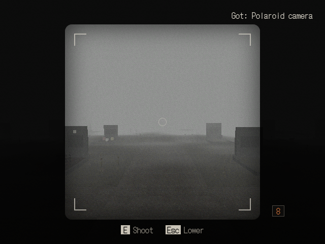 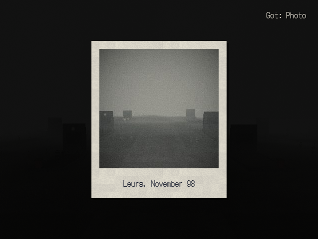 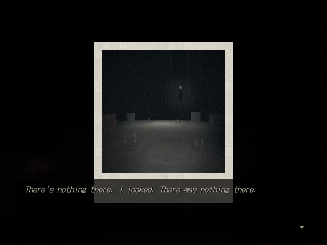

### The notebook

The `notebook` item opens the quest log on ruled paper, at the latest page. It lists every entry in `src/content/notebook.ts` whose key flag holds (derived flags included) and whose own `if` holds now, in story order.

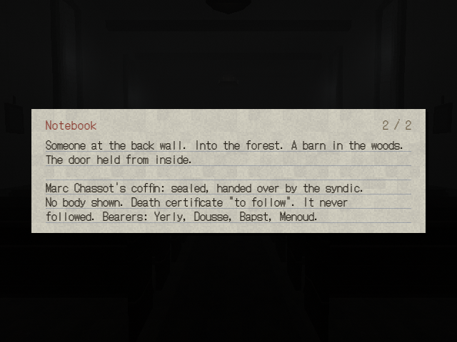 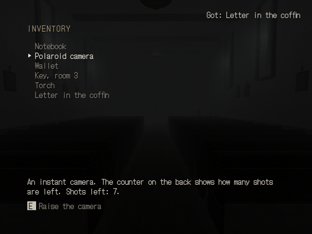

## Title screen and settings

The game opens on the title screen in `src/title/`: "Le Loyon" in a plain serif over drifting fog and static, with a low drone on the music bus. "New game" starts the prologue in `home`. "Continue" appears when slot `main` or `sleep` holds a save and loads the newer one. "Settings" opens the settings. "Quit" appears only in the desktop app.

Settings live in `localStorage` under `le-loyon.settings` and apply at once: volume for each audio bus, brightness (a CSS filter on the frame), invert turning, and subtitles. The pause menu opens the same screen. `Game.applySettings(settings)` applies a changed copy from code.

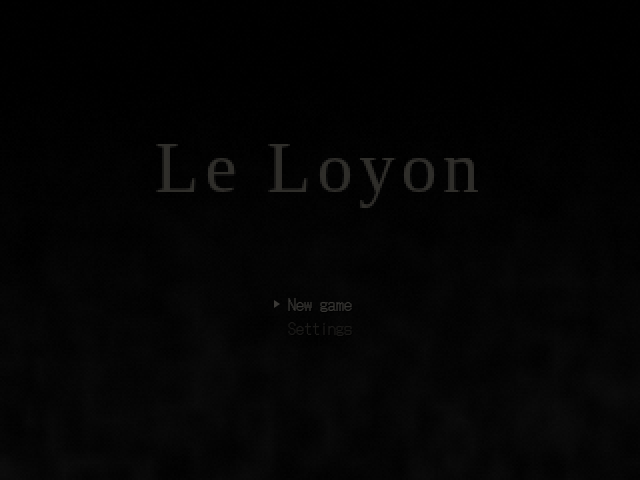 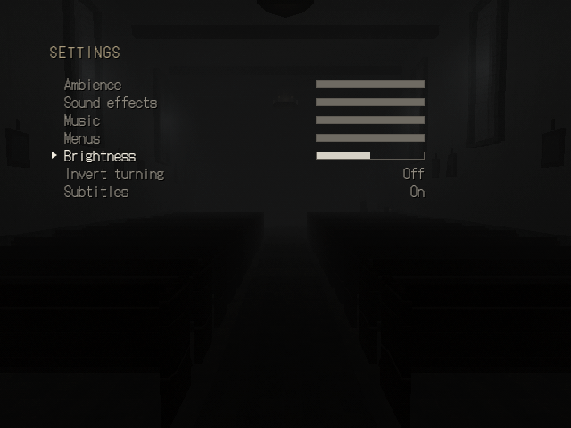

## Audio

`ctx.audio` is the `AudioManager`, with four buses: `ambience`, `sfx`, `ui`, `music`. The browser unlocks audio on the first key press or click; the desktop app plays at once.

```ts
const radio = ctx.audio.play('assets/audio/radio.ogg', { bus: 'sfx', loop: true, at: { x: 2, y: 1, z: -3 } });
radio.stop(1); // fade out over 1 second
```

- `play(url, { bus, volume, loop, rate, at, refDistance })` plays a file. With `at`, it is positional with an HRTF panner.
- `fadeBus(bus, level, seconds)` fades a whole bus. Scene changes fade the ambience, sfx, and music buses back to `busLevel(bus)`. `setBusVolume(bus, 0 to 1)` scales a bus from its mixed level; the volume settings use it.
- Generators in `src/engine/audio/generators.ts`: `wind`, `drone`, `crackle`, `click`, plus `noiseBurst` and `thump` for building new sounds.
- `playFootstep(audio, surface, { at, level })` in `src/engine/audio/footsteps.ts` synthesizes one step. The player's steps play from the `footstep` event. Pass `at` for steps that aren't the player's.

Sounds started with `kit.sound` or `kit.ambience` stop with the scene. Stop sounds from `ctx.audio.play` yourself in `dispose`, or track them with `world.sounds` through `kit`.

## Controls

| Action | Keyboard | Gamepad |
|---|---|---|
| Walk forward, back | W, S, Up, Down | Left stick, d-pad |
| Turn | A, D, Left, Right | Left stick, d-pad |
| Walk faster | Shift | RB or RT |
| Interact, confirm | E, Enter, Space | A |
| Back, cancel | Esc, Backspace | B |
| Inventory | Tab, I | Y |
| Flashlight | F | X |
| Crouch | C, Ctrl | LB |
| Camera | Q | LT |
| Pause | Esc | Start |

Bindings live in `src/engine/input/bindings.ts`. Player speeds, turn rate, eye height (1.65 m), head bob, and field of view (60) live in `playerTuning` in `src/engine/player.ts`.

## Example level

A complete scene: a small chapel yard at the edge of the forest, with a locked chapel door, a priest's note, and a lamp that only burns at night. Save it as `src/levels/chapel/index.ts` and add `export const scenes = [chapelScene];` at the end.

```ts
import { playFootstep } from '../../engine/audio/footsteps';
import type { DialogueScript } from '../../game/dialogue';
import { registerItems } from '../../game/items';
import { scatter } from '../../game/kit/scatter';
import { defineScene, type SceneContext } from '../../game/scene';

registerItems({
  chapel_key: { name: 'Chapel key', description: 'Long and black. Still warm.' },
});

const note: DialogueScript = {
  start: 'note',
  nodes: {
    note: {
      lines: ['A note under a stone: "Key behind the grave of D. Menoud."'],
      choices: [
        { text: 'Look behind the grave', if: { notItem: 'chapel_key' }, effects: { give: 'chapel_key' }, next: 'found' },
        { text: 'Leave it' },
      ],
    },
    found: { lines: ['Cold iron in the wet grass.'] },
  },
};

export const chapelScene = defineScene({
  id: 'chapel',
  spawns: {
    default: { x: 0, z: 8, yaw: 0 },
    from_chapel: { x: 0, z: -1.5, yaw: 180 },
  },
  atmosphere: {
    day: {
      fog: { color: 0x9a9c98, near: 1, far: 15, density: 0.08 },
      ambient: 0x6c6c68,
      sun: { color: 0x504f4a, direction: [0.3, 1, 0.4] },
    },
    night: {
      fog: { color: 0x060709, near: 0.5, far: 12, density: 0.12 },
      ambient: 0x121418,
    },
  },

  build(kit, ctx) {
    const night = ctx.state.time === 'night';

    kit.ground('grass');
    // Flat along the path (|x| < 1.5), gently rolling further out.
    const hills = (x: number, z: number) => 0.3 * Math.min(1, Math.max(0, Math.abs(x) - 1.5) / 3) * Math.sin(x * 0.3) * Math.cos(z * 0.25);
    kit.terrain({ w: 50, d: 50, cell: 2, height: hills })
      .texture('grass_dead', { tile: 4 })
      .walkable('grass');
    kit.plane({ w: 2, d: 10, cell: 0.75 }).texture('gravel_path', { tile: 2 }).at(0, 0.02, 3).walkable('gravel');

    // The chapel: walls, a roof, and a door that leads inside.
    kit.group((g) => {
      g.box({ w: 6, h: 3.2, d: 0.4 }).texture('church_stone', { tile: 2.5 }).at(0, 0, 0).collider();
      g.box({ w: 6, h: 3.2, d: 0.4 }).texture('church_stone', { tile: 2.5 }).at(0, 0, -7).collider();
      g.box({ w: 0.4, h: 3.2, d: 7 }).texture('church_stone', { tile: 2.5 }).at(-2.8, 0, -3.5).collider();
      g.box({ w: 0.4, h: 3.2, d: 7 }).texture('church_stone', { tile: 2.5 }).at(2.8, 0, -3.5).collider();
      g.gable({ w: 7.6, d: 6.6, h: 2.4 }).texture('roof_tiles', { tile: 2 }).at(0, 3.2, -3.5).rotY(90);
      g.door({
        to: 'chapel_inside',
        locked: () => !ctx.state.hasItem('chapel_key'),
        lockedText: 'The chapel door is locked.',
      }).at(0, 0, 0.22);
    }).at(0, 0, -2);

    // A note on the path and, at night, a lamp by the door.
    kit.hotspot({ prompt: 'Read the note', radius: 0.4, onInteract: () => ctx.dialogue(note) }).at(1.2, 0, 4);
    kit.cylinder({ r: 0.05, h: 2.8, sides: 6 }).texture('rust_metal').at(-1.6, 0, -1.4);
    if (night) {
      kit.box({ w: 0.25, h: 0.3, d: 0.25 }).unlit().color(0xffcf86).at(-1.6, 2.8, -1.4);
      kit.glow(1.4).at(-1.6, 2.95, -1.4);
      kit.light({ color: 0xffc070, intensity: 2.4, range: 8 }).flicker(0.2).at(-1.6, 2.9, -1.4);
    }

    // Forest all around, with the path kept clear.
    const clearing = (x: number, z: number) => Math.hypot(x, z + 2) < 7 || (Math.abs(x) < 2 && z > 0);
    kit.trees('spruce', scatter({ x: 0, z: 0, w: 44, d: 44, count: 60, seed: 'chapel', spacing: 2.5, avoid: clearing })).collider().shade(0.12);

    // Fog hides the edges; barriers stop the player there.
    kit.barrier({ w: 44, d: 1 }).at(0, 0, -22);
    kit.barrier({ w: 44, d: 1 }).at(0, 0, 22);
    kit.barrier({ w: 1, d: 44 }).at(-22, 0, 0);
    kit.barrier({ w: 1, d: 44 }).at(22, 0, 0);
    kit.exit({ w: 2, d: 1, to: 'village', spawn: 'from_chapel' }).at(0, 0, 9.5);

    // Something walks past once, the first night the player comes here.
    kit.trigger({ w: 4, d: 2 }).at(0, 0, 5).once().onEnter(() => {
      if (night) playFootstepsBehind(ctx);
    });

    kit.ambience('wind', { volume: 0.45 });
    if (night) kit.ambience('crackle', { interval: 4 });
  },
});

/** Three steps on gravel, six meters behind the player. */
function playFootstepsBehind(ctx: SceneContext): void {
  const behind = ctx.player.position.clone().addScaledVector(ctx.player.forward(), -6);
  [0, 0.7, 1.4].forEach((delay) =>
    setTimeout(() => playFootstep(ctx.audio, 'gravel', { at: { x: behind.x, y: 0, z: behind.z } }), delay * 1000),
  );
}
```

The door and the exit lead to `chapel_inside` and `village`, which must be registered scenes too. For a fuller scene, read `src/levels/test/`.

## Rendering notes

- The scene renders into a 640x480 target. A post pass reduces it to 15-bit color with a 4x4 Bayer dither and light grain, and CSS scales the canvas with nearest-neighbor filtering into a letterboxed frame. The frame uses a whole-number scale when that loses less than 15% of the space.
- The PS1 material snaps vertices to a 320x240 grid, so geometry wobbles as the camera moves. Change `ps1Uniforms.uSnap` in `src/engine/render/ps1Uniforms.ts` to tune it.
- Textures are affine-mapped (they warp on big polygons, as on the PS1), sampled with nearest filtering, and have no mipmaps.
- Lighting is per vertex: ambient, one directional light, up to 8 point lights, and the flashlight. Light can reach 2x brightness. Lamps and the flashlight also brighten the fog near what they light.
- The UI is HTML laid out in 640x480 frame pixels and scaled with the frame. The font is DotGothic16 at 16 px, and 12 px for subtitles. At fractional frame scales, an SVG filter rounds the alpha of every text pixel to 0 or 1, so text keeps hard edges like the nearest-neighbor 3D frame.

## Known limits

- No glTF loading yet. Build props from kit shapes or `kit.mesh`.
- Collision is 2D. There are no stairs or jumps; ramps and steps up to 0.45 m work through walkable ground patches.
- Sprites turn around Y only, so they look flat from above.
- The pause menu saves to one slot, `main`; `writeSave` and `readSave` take any slot name.
