# Playthrough test

`npm run playthrough` plays the game from the title screen to each ending in headless Chromium, the way a player would, and fails at the first step the game doesn't let it take. It is the check that the areas built by separate agents still join up into one game.

| Run | Path | Ends with |
|---|---|---|
| `publish` | Prologue, day 1, night 1, day 2, the dig with the grave filled in, day 3 with food, the right knock, Marc's consent to a photo, the ring, the phone | `ending_publish`, the front page |
| `secret` | The same days, but the grave left open, Monique's cold morning, the door unlocked without knocking, a forced photo | `ending_secret` |
| `leave` | Prologue, day 1 to the abbé, then the bus stop | `ending_leave` |
| `caught` | Night 2 set up through the debug URL, then digging with the torch on until Raymond comes | `caught`, then "Continue from the last sleep" |

A full run of all four takes about 25 minutes: `publish` and `secret` about 11 each, `leave` 1.5, `caught` 1. It needs no GPU.

```sh
npm run playthrough                         # all four runs
npm run playthrough -- leave caught         # some of them
npm run playthrough -- publish --from night_2_dig --to day_3_veilleur
TALK_DEBUG=1 npm run playthrough -- leave   # log every dialogue step
```

`--from` starts a run at a stage with the state the previous stage ended with in an earlier run. Each stage writes that state to `$TMPDIR/le-loyon-playthrough/<stage>.json`. A failed run saves its last frame and state there as `failed-<run>.png` and `failed-<run>.json`.

## What it checks

Each stage in `tools/playthrough/runs.mjs` plays one step of the flow in [script/00-overview.md](script/00-overview.md) and then checks the flags, items, and counts the script says that step sets. Along the way it checks:

- every door, exit, and trigger on the path loads the scene it should, at a spawn the player can walk on from;
- every interaction on the path is enabled when the story needs it, and shows its prompt when the player faces it;
- every dialogue offers the choices the run picks;
- waking in room 3 and setting out on night 2 write the `sleep` save, and the caught screen loads it with `caught` cleared;
- on night 1, `first_sighting` is set only once the reporter reacts at the back wall, not when the figure appears;
- on day 2, looking at the cupboard leads to the swept dust, and `13-hidden-door` shows the K.P. 3 door once the cupboard has rolled clear;
- Odile's kitchen opens at `odile_talk_2`;
- each ending's pages, epilogue, and last screen play and return to the title.

Night 2 plays puzzle P5 for real at four times speed. The run digs while Raymond is offstage; when his round comes within 28 m it climbs out, pulls the tarp over the hole, and waits in the ossuary shed with the torch off until he has gone. A dig stage takes 15 s of game time and a refill stage 12 s, so the dig takes about two rounds. On his second round Raymond stops at Marc's grave for 10 s while Bari growls, then moves on. The run waits that out in the shed like any other round. After the last dig stage it waits out one more round, then opens and empties the coffin at normal speed in the quiet minute after it.

## How it plays

The runner in `tools/playthrough/index.mjs` starts the Vite dev server and Chromium with the same SwiftShader flags as `npm run shot` (`tools/browser.mjs`), and gives each run a fresh page, so saves and settings start empty. The dev server doesn't watch files or reload the page, so edits made during a run, by you or another agent, don't restart a stage. Start the run again to test them.

`tools/playthrough/session.mjs` holds the moves. Keys go in as real key presses through Playwright: E to interact and confirm, the arrows to walk and pick choices, F, C, and Q for the torch, crouching, and the camera. The 1998 desktop is driven with real key presses: up and down to move between links, E to open, Esc to go back, Tab for the Start menu. Everything else goes through `window.__game`:

| Hook | Used for |
|---|---|
| `approach(prompt, near?)` | Stands the player on free ground facing the interaction with that prompt. The run then checks the prompt shows and presses E. |
| `hotspots()` | Waits until an interaction is available, and finds where it is. |
| `characters()` | Finds who to talk to, and whether Raymond is on his round. |
| `modal()`, `dialogue()` | Plays dialogues and documents through. |
| `teleport()`, `pose()` | Moves between places on the path; doors and exits are still walked through. |
| `setSpeed(n)` | Runs the game clock faster through the dig and the long silences on night 1. |

`npm run shot` also takes `--day` and `--night` counts and passes them to the debug URL, as the `caught` run does with `?scene=inn&time=night&day=2&night=2&flags=...`. For example, `npm run shot -- --scene cemetery --time night --night 2 --out /tmp/dig.png`.

## Writing a stage

`node tools/playthrough/peek.mjs "scene=church&day=2"` lists a scene's enabled interactions with their prompts and positions, and who is on stage. A stage is an object:

```js
const odile = {
  name: 'day_2_odile',
  flags: ['odile_talked'],
  items: ['gremaud_diary'],
  async play(s) {
    await s.walkOut(10, 13.5, -90, 'house_gremaud');
    await s.use('Ring the bell');
    await s.awaitTalk('Odile at the door');
    // ...
  },
};
```

Shots go to `docs/screenshots/flow-<nn>-<name>.png`, one for each step of the story. Prefer a shot taken mid-stage with `s.shot(name)`, at the moment the step is about; `shot: name` on a stage takes it when the stage ends.

## Screenshots

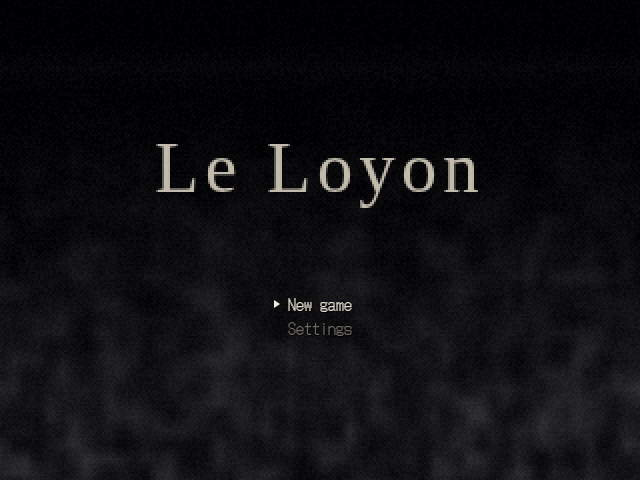 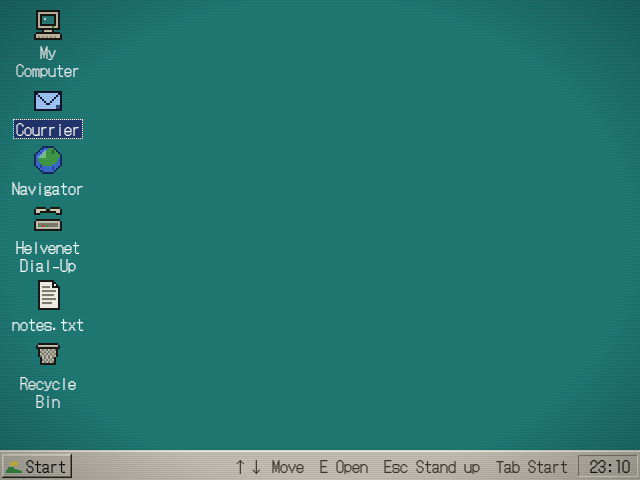 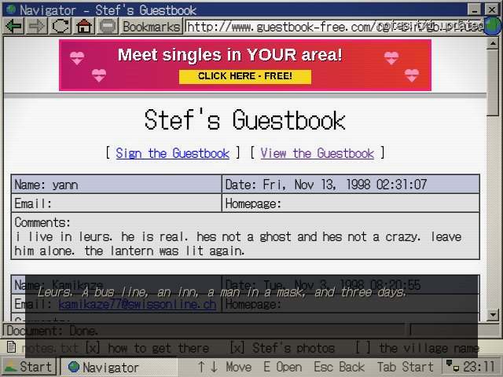
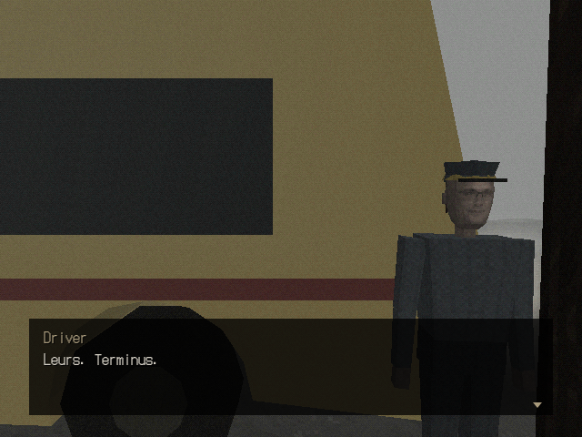 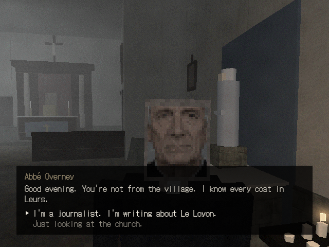 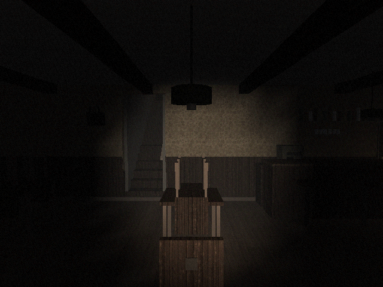
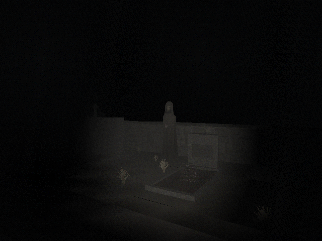 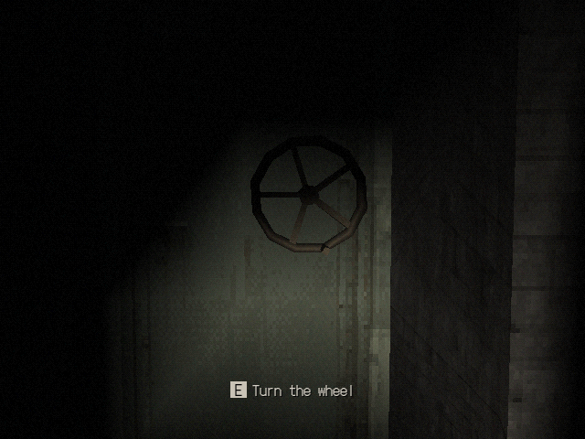 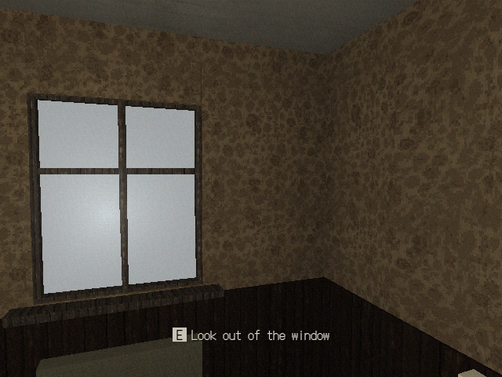
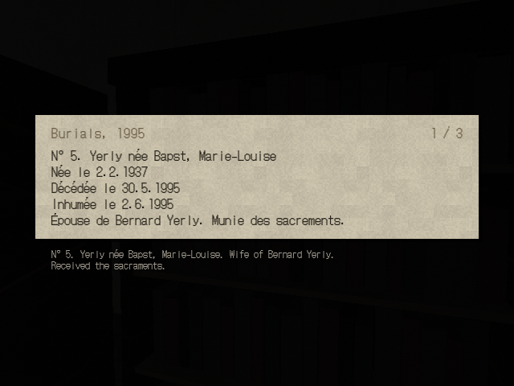 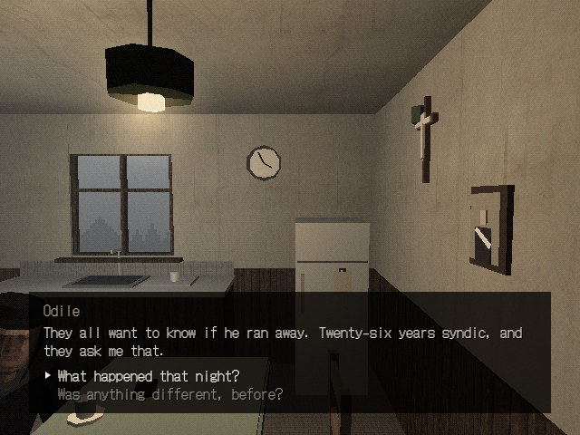 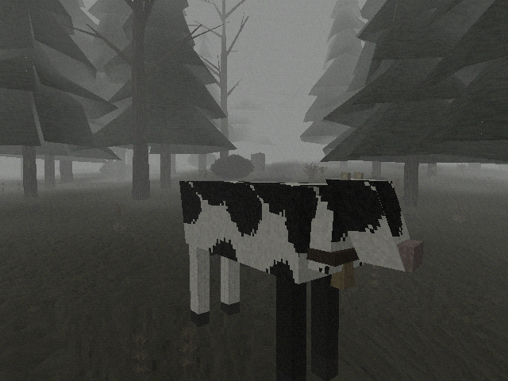
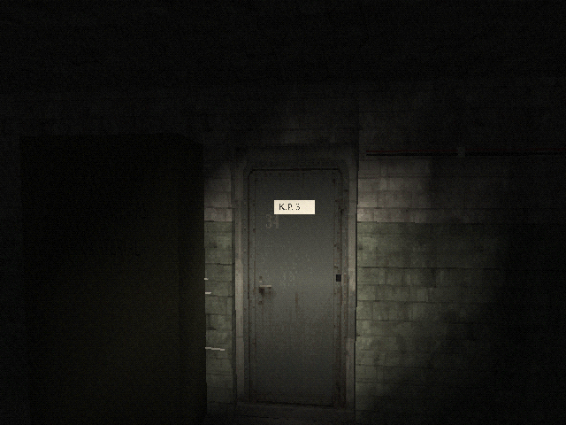 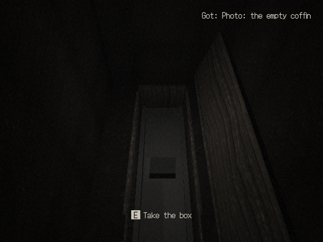 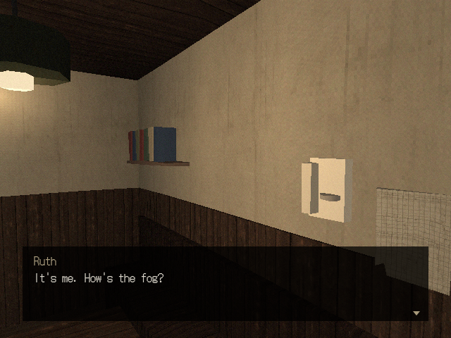
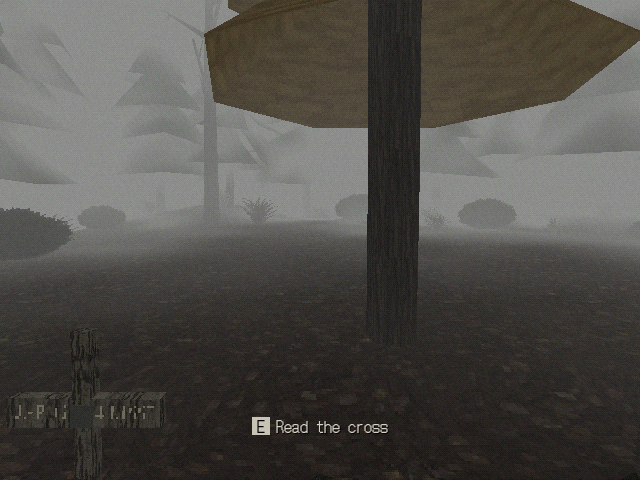 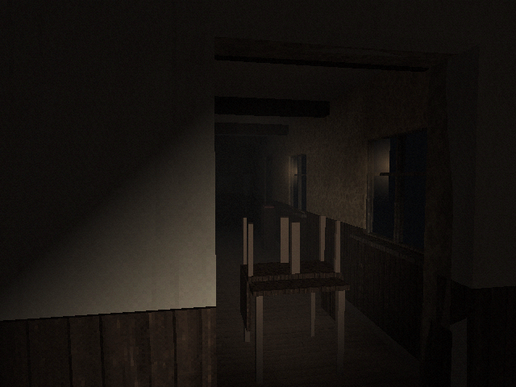 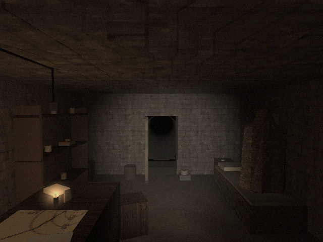
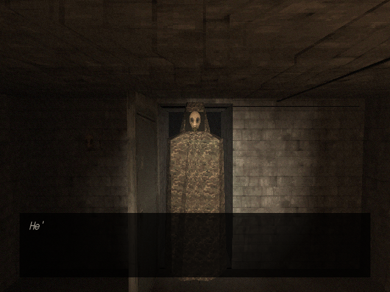 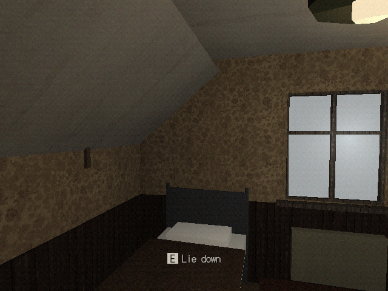 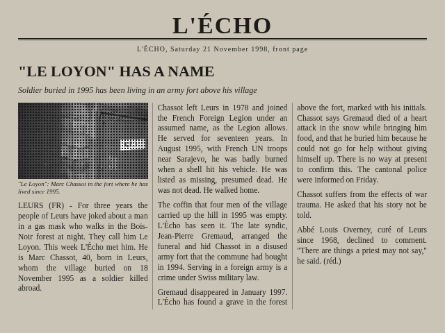
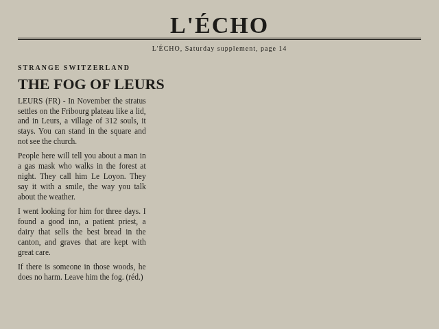 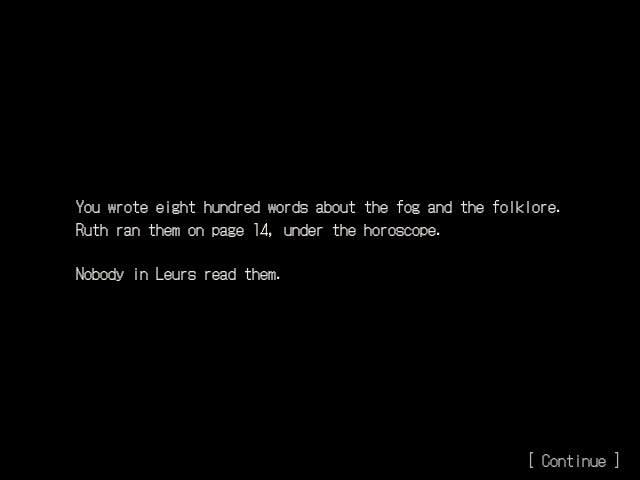 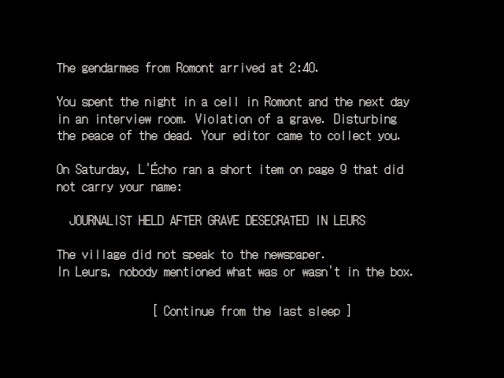
